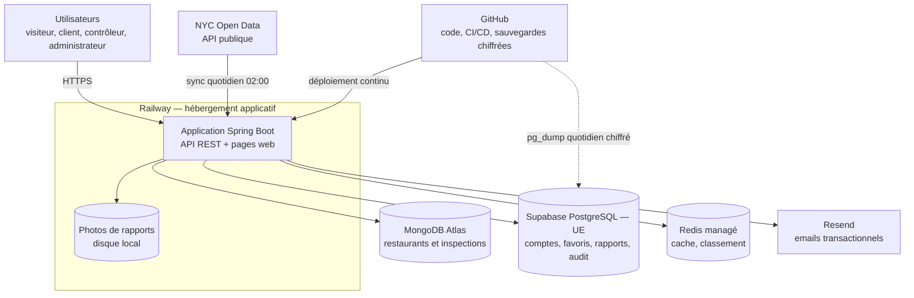

# Dossier d'analyse stratégique

**Certification** : RNCP niveau 7 — Expert en informatique et système d'information (3W Academy)
**Bloc** : 1 — Analyser et définir une stratégie de systèmes d'information
**Livrable** : Dossier d'analyse stratégique
**Candidat** : Arnaud Thery
**SI analysé** : `restaurant-analytics`

> Ce dossier s'appuyait initialement sur *"Étude de cas Aflokkat"* (document de groupe, Drive) — devenu inaccessible au moment de la rédaction. Il est donc reconstruit intégralement à partir du système d'information réel du candidat, `restaurant-analytics`, dans la même logique que les Blocs 2.1-2.3, 3 et 4A : tout ce qui suit est vérifiable dans le dépôt, pas projeté.

---

## 1. Enjeux et orientations stratégiques

`restaurant-analytics` a démarré comme exercice académique (module big data, Aflokkat) et a évolué en un service à trois enjeux distincts, qui se sont ajoutés au fil du projet plutôt que d'être fixés a priori (cf. Bloc 2.3, §2.1 — objectifs fixés vs atteints) :

1. **Enjeu pédagogique initial** — démontrer une maîtrise technique (ingestion de données publiques, agrégations, API REST) sur un cas concret.
2. **Enjeu de portfolio** — un service réellement déployé et utilisable, pas un exercice jetable : démo publique en production, données réelles synchronisées en continu.
3. **Enjeu de certification** — depuis juillet 2026, le SI sert de support technique à tous les livrables de la certification RNCP, à l'exception du cahier des charges fonctionnel (Bloc 1.2), produit en groupe dans le cadre du projet de formation Aflokkat.

**Orientation stratégique retenue** : maintenir un SI à coût et à complexité opérationnelle minimaux (développeur unique, hébergement à trafic modéré), plutôt que de viser une architecture dimensionnée pour une montée en charge hypothétique — cohérent avec l'absence d'enjeu commercial réel à ce stade. Cette orientation a concrètement guidé des décisions récentes : arrêt d'Elasticsearch en production (juillet 2026) faute de trafic justifiant son coût, limite mémoire applicative resserrée sur la base de métriques observées plutôt que sur un plan de croissance.

---

## 2. Diagnostic du SI actuel

### 2.1 Périmètre fonctionnel

Application web (Spring Boot + Thymeleaf) à 4 profils (visiteur anonyme, client, contrôleur d'hygiène, administrateur), organisée autour de trois bases de données aux rôles disjoints (MongoDB pour les données restaurant, PostgreSQL pour les données utilisateur, Redis pour le cache) et d'une synchronisation nocturne automatisée depuis une source de données publique externe (NYC Open Data). Détail complet : [`bloc2-1-cahier-des-charges-techniques.md`](bloc2-1-cahier-des-charges-techniques.md).

### 2.2 Cartographie du système d'information

| Flux | Nature des données | Fréquence | Sens |
|---|---|---|---|
| Synchronisation NYC Open Data | Inspections publiques (données ouvertes) | Quotidienne, 02:00 | Entrant |
| Requêtes des utilisateurs | Recherches, consultations, favoris, rapports | Continue | Entrant / sortant |
| Emails de réinitialisation | Adresse email, lien à usage unique | À la demande | Sortant (Resend) |
| Sauvegarde PostgreSQL | Dump complet chiffré (GPG AES256) | Quotidienne | Sortant (GitHub Actions) |
| Déploiement | Code compilé | À chaque fusion sur `main` | Entrant (GitHub → Railway) |

### 2.3 Inventaire des fonctions informatiques existantes

| Domaine fonctionnel | Fonctions | Profils | Données utilisées |
|---|---|---|---|
| Consultation | Recherche par nom ou adresse, fiche restaurant, historique des inspections, restaurants à proximité | Tous | MongoDB, cache Redis |
| Cartographie | Carte des inspections filtrable (borough, cuisine, grade) | Tous | MongoDB |
| Analyse | KPI ville, distribution des grades par borough, classement des cuisines, restaurants à risque, restaurants non contrôlés (export CSV) | Tous | MongoDB, cache Redis |
| Compte | Inscription, connexion, mot de passe oublié, suppression de compte | Client, contrôleur, administrateur | PostgreSQL, Resend |
| Favoris | Ajout, retrait, liste des favoris | Client | PostgreSQL |
| Rapports terrain | Création, édition, photo, suivi par statut | Contrôleur | PostgreSQL, disque |
| Administration | Changement de rôle, synchronisation manuelle, reconstruction du cache, tâches planifiées, journal d'audit, statistiques de rapports, export CSV des restaurants à risque | Administrateur | PostgreSQL, MongoDB, Redis |
| Exploitation (automatique) | Synchronisation quotidienne, réchauffement du cache, sauvegarde chiffrée | — | Toutes |

### 2.4 Maturité par domaine

| Domaine | Maturité | Constat |
|---|---|---|
| **Fonctionnel** | Élevée | 4 profils utilisateurs opérationnels, périmètre stable depuis mai 2026 |
| **Sécurité** | Élevée | JWT en cookies httpOnly, rate limiting, scan de secrets en CI, conformité RGPD partielle (voir §4) — détail : [`bloc4a-1-analyse-risques.md`](bloc4a-1-analyse-risques.md) |
| **Qualité / tests** | Élevée | CI à 5 vérifications obligatoires avant fusion, couverture JaCoCo suivie — détail : [`bloc3-2-dossier-technique.md`](bloc3-2-dossier-technique.md) |
| **Gouvernance de projet** | Faible historiquement, en progression | Aucune note de cadrage ni planification formelle n'existait avant juillet 2026 (Blocs 2.2/2.3) — reconstruites a posteriori, pas pilotées a priori |
| **Résilience opérationnelle** | Moyenne | Sauvegardes PostgreSQL chiffrées quotidiennes (depuis le 23/07/2026) ; MongoDB sans sauvegarde dédiée mais entièrement re-dérivable de la source NYC Open Data — choix assumé, pas un oubli |
| **Documentation** | Élevée, avec dérive résiduelle constatée | `docs/` et `CLAUDE.md` mis à jour à chaque fonctionnalité livrée ; une référence obsolète (`map.html` au lieu de `inspection-map.html`) a néanmoins été trouvée et corrigée le 29/07/2026 en préparant ce dossier — signe que le contrôle documentaire, bien qu'en place, n'est pas infaillible |

### 2.5 Dépendances externes structurantes

| Dépendance | Rôle | Niveau de maîtrise |
|---|---|---|
| API NYC Open Data | Source unique des données restaurant | Faible — SLA informel, pas de fournisseur alternatif identifié |
| Railway (hébergement applicatif) | Exécution et déploiement continu | Moyen — migration possible mais non testée |
| MongoDB Atlas | Hébergement des données restaurant | Moyen — re-synchronisable entièrement depuis la source, donc portable |
| Supabase (région `eu-west-1`, UE) | Hébergement PostgreSQL | Moyen — sauvegardes quotidiennes chiffrées hors Supabase |
| Resend | Envoi d'emails transactionnels (reset de mot de passe) | Faible — fonctionnalité dégradée proprement en cas de panne, non bloquante pour le cœur de service |

---

## 3. Processus améliorables

| Processus actuel | Limite constatée | Amélioration envisageable |
|---|---|---|
| Revue de code | Auto-portée (développeur unique) | Compensée par la CI obligatoire, mais aucun regard humain tiers — acceptable en solo, redevient un vrai risque si l'équipe grandit |
| Suivi de projet | Reconstruit a posteriori depuis `CHANGELOG.md` plutôt que planifié a priori (cf. Bloc 2.3) | Adopter une planification légère mais réelle (même a minima) pour les évolutions futures, plutôt que de continuer à documenter après coup |
| Contrôle de cohérence documentation/code | Convention déclarée mais non outillée (pas de vérification automatique) | Un test ou un job CI qui détecte les références de fichiers obsolètes dans `docs/` réduirait la dérive constatée en 2.4 |
| Décision de coût d'infrastructure | Ponctuelle, réactive (ex. arrêt d'Elasticsearch décidé après observation de métriques) | Revue périodique planifiée des coûts d'hébergement plutôt qu'une réaction a posteriori |

---

## 4. Cohérence avec les obligations réglementaires (RGPD)

| Obligation RGPD | État | Preuve / écart |
|---|---|---|
| Droit à l'effacement (art. 17) | Conforme depuis le 2026-07-29, avec un écart résiduel | `DELETE /api/users/me` (`UserController.java:168`) — cascade rapports (+ photos), favoris, jetons de réinitialisation ; anonymise les entrées d'audit (`actorUsername` → `[deleted-user]`). Le pentest a montré que la suppression échouait pour une partie des utilisateurs jusqu'au 2026-07-29 (Bloc 4A.2, §2.2). Écart restant : l'entrée d'audit `USER_DELETED` conserve le nom d'utilisateur supprimé (Bloc 4A.2, §3.2) |
| Minimisation des données (art. 5) | Conforme pour les comptes, à surveiller pour les photos | Comptes limités à nom d'utilisateur, email, mot de passe haché, rôle. Les photos de rapports peuvent contenir des visages ou des écritures (risque R3, Bloc 4A.1) |
| Sécurité des données (art. 32) | Conforme | Mots de passe hachés BCrypt, JWT en cookies httpOnly, Row-Level Security PostgreSQL, sauvegardes chiffrées (GPG AES256, `.github/workflows/backup-postgres.yml`) |
| Traçabilité | Partielle | `audit_log` journalise les actions sensibles (suppression de compte, actions admin), mais pas les connexions |
| Information des personnes (art. 13) | **Non conforme** | Aucune politique de confidentialité publiée dans l'application, alors que l'inscription est ouverte au public |
| Registre des traitements (art. 30) | **À constituer** | L'exemption des structures de moins de 250 personnes ne s'applique pas à un traitement non occasionnel comme la gestion de comptes : un registre simplifié (comptes, rapports, emails, audit) est nécessaire |
| Sous-traitants et localisation (art. 28 et 44) | Partiellement documenté | PostgreSQL chez Supabase en UE (`eu-west-1`) ; localisation et garanties de transfert à documenter pour Railway (photos), Resend (emails) et MongoDB Atlas (données publiques, sans donnée personnelle) |
| Délégué à la protection des données (art. 37) | Non obligatoire | Ni organisme public, ni suivi à grande échelle, ni données sensibles |

**Cohérence avec les orientations stratégiques (section 1)** : l'effort de conformité RGPD engagé en juillet 2026 (v2.3.0-2.4.0) est directement aligné avec l'enjeu de certification (le Bloc 4A évalue explicitement la gestion des risques SI) — la priorisation observée dans le temps (sécurité et RGPD traités juste avant la phase de rédaction certificative) n'est pas une coïncidence mais un choix cohérent avec les enjeux du projet.

---

## 5. Priorités et évolutions préconisées

Risques stratégiques évalués (distincts des risques techniques/sécurité déjà cartographiés au Bloc 4A.1, R1-R10) :

Les montants en jours-homme sont valorisés sur la base d'un taux journalier indicatif de 450 € (développeur Java en prestation) — hypothèse de calcul, le projet n'ayant pas de coût de main-d'œuvre réel.

| # | Risque stratégique | Probabilité (1-4) | Impact (1-4) | Score | Montant estimé | Priorité |
|---|---|---|---|---|---|---|
| S1 | **Risque de dépendance à une personne clé** — développeur unique, aucune continuité documentée en cas d'indisponibilité prolongée | 2 | 4 | 8 | Reprise en main par un tiers : 3 à 5 jours-homme, soit 1 350 à 2 250 € | **Haute** |
| S2 | **Dépendance à une source de données non contractualisée** (NYC Open Data) — panne ou changement de schéma sans préavis | 2 | 3 | 6 | Pas de coût direct (source gratuite) ; adaptation à un changement de schéma ou ajout d'un mode dégradé : 1 à 2 jours-homme, soit 450 à 900 € | Moyenne |
| S3 | **Dérive de coût d'hébergement** si le trafic ou le périmètre augmentent sans revue | 2 | 2 | 4 | ~20-30 $/mois actuellement (Railway, seul service payant) ; un doublement non détecté représenterait 240 à 360 $/an | Moyenne |
| S4 | **Dette de gouvernance** — absence de cadrage/planification a priori, gérable en solo mais non réplicable telle quelle en contexte d'équipe | 3 | 2 | 6 | Formation d'un nouvel arrivant : 2 à 3 jours-homme, soit 900 à 1 350 € | Moyenne |
| S5 | **Non-conformité RGPD résiduelle** — pas de politique de confidentialité ni de registre, alors que l'inscription est ouverte (§4) | 2 | 3 | 6 | Amende CNIL en procédure simplifiée : jusqu'à 20 000 € ; mise en conformité : environ 1 jour-homme (450 €) | Moyenne |

**Évolutions préconisées, par ordre de priorité :**

1. **Documenter une procédure de reprise en main** (S1) — un guide "si je disparais demain" au-delà de `CLAUDE.md`/`docs/` actuels : où sont les secrets, comment redéployer, qui contacter pour chaque service tiers.
2. **Ajouter un fallback ou une alerte sur la source NYC Open Data** (S2) — actuellement non traité (R7 du Bloc 4A.1) ; a minima, une alerte si le sync nocturne échoue plusieurs jours de suite.
3. **Formaliser une revue trimestrielle de coût d'infrastructure** (S3) plutôt que des ajustements réactifs.
4. **Clarifier le statut de gouvernance** (S4) avant toute extension du projet à une équipe — trancher la question déjà posée à Aflokkat sur le périmètre du Bloc 2.4 (projet solo vs projet de groupe) en est un prérequis direct.
5. **Mettre la conformité RGPD à niveau** (S5) : publier une politique de confidentialité (finalités, durées de conservation, droits, sous-traitants) et tenir un registre simplifié — environ 1 jour-homme, à faire avant toute ouverture plus large du service.

---

## Renvoi croisé

- Cahier des charges techniques : [`bloc2-1-cahier-des-charges-techniques.md`](bloc2-1-cahier-des-charges-techniques.md)
- Analyse des risques SI (sécurité, technique) : [`bloc4a-1-analyse-risques.md`](bloc4a-1-analyse-risques.md)
- Dossier de planification + bilan : [`bloc2-3-dossier-planification-bilan.md`](bloc2-3-dossier-planification-bilan.md)
