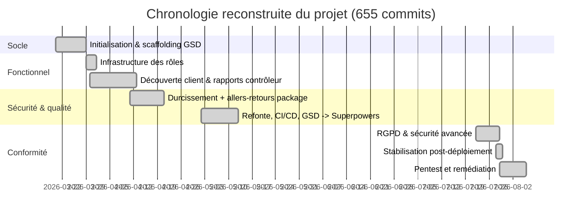

# Dossier de planification d'un projet informatique (+ bilan)

**Certification** : RNCP niveau 7 — Expert en informatique et système d'information (3W Academy)
**Bloc** : 2 — Piloter et manager les projets informatiques
**Livrable** : Dossier de planification (inclut le bilan)
**Candidat** : Arnaud Thery
**Projet** : `restaurant-analytics`

> Comme pour la note de cadrage (Bloc 2.2), ce document reconstitue a posteriori une planification qui n'a pas été formalisée a priori — le projet a été mené en développement solo itératif, sans jalons fixés à l'avance. Les phases ci-dessous sont reconstruites à partir de l'historique Git réel (655 commits, 2026-03-20 → 2026-08-05) et de `CHANGELOG.md`, pas d'une intention projetée.

---

## Partie 1 — Planification

### 1.1 Phases du projet

| Phase | Période | Durée | Contenu |
|---|---|---|---|
| **0 — Socle initial** | 2026-03-20 → 2026-03-29 | 9 j | Premier commit (API Spring Boot), scaffolding méthodologique GSD (`.planning/`) |
| **1 — Infrastructure des rôles** | 2026-03-29 → 2026-03-31 | 3 j | `ROLE_CUSTOMER`/`ROLE_CONTROLLER`, JWT access/refresh, rate limiting, comptes de test (`DataSeeder`) |
| **2 — Découverte client & rapports** | 2026-03-30 → 2026-04-12 | 14 j | Recherche, carte interactive, favoris, rapports d'hygiène contrôleur, upgrade Java 11→25 et Spring Boot 2.6→4.0, migration Testcontainers |
| **3 — Durcissement sécurité** | 2026-04-11 → 2026-04-20 | 10 j | CORS, en-têtes de sécurité, rate limiting renforcé — période marquée par deux allers-retours sur le nommage du package (`com.aflokkat` ↔ `com.st4r4x`, voir 1.2) |
| **4 — Refonte & CI/CD** | 2026-05-02 → 2026-05-12 | 11 j | v2.0 → v2.2.4 : refonte frontend, pipeline CI à 5 jobs, recherche Elasticsearch, journal d'audit, enrichissement OpenStreetMap ajouté puis retiré (voir 1.2), **transition méthodologique GSD → Superpowers** (voir 1.2) |
| **5 — Conformité & sécurité avancée** | 2026-07-22 → 2026-07-28 | 7 j | v2.3.0 → v2.4.0 : suppression de compte RGPD, migration JWT vers cookies httpOnly, sauvegardes PostgreSQL chiffrées, réinitialisation de mot de passe |
| **6 — Stabilisation post-déploiement** | 2026-07-28 → 2026-07-29 | 2 j | v2.4.1 : correction d'une régression détectée en production, automatisation partielle des releases, rédaction Blocs 2.1/2.2/2.3 |
| **7 — Audit de sécurité et remédiation** | 2026-07-29 → 2026-08-05 | 8 j | Pentest de l'instance de production, 3 vulnérabilités corrigées et revérifiées, Row-Level Security PostgreSQL |

Aucun commit n'a été produit entre le 13/05 et le 21/07 : cette pause de dix semaines n'était pas planifiée et explique l'écart entre les phases 4 et 5.

### 1.3 Ressources et budget

| Ressource | Mobilisée | Mesure |
|---|---|---|
| Humaine | 1 développeur en alternance | 35 jours d'activité (jours avec au moins un commit), répartis : mars 6, avril 17, mai 6, juillet 5, août 1 |
| Production | 617 commits hors fusions, 32 pull requests | Historique Git |
| Infrastructure | Railway (seul service payant), MongoDB Atlas, Supabase, Redis, Resend, GitHub (offres gratuites) | ~20-30 $/mois |
| Budget valorisé | ~15 750 € de charge (35 j × 450 € indicatifs) + ~120-180 $ d'hébergement sur 6 mois | Détail et hypothèses : note de cadrage (Bloc 2.2, §8) |

### 1.2 Déroulement analysé — mesures correctives effectivement prises

Quatre écarts identifiés et corrigés en cours de route, documentés ici avec honnêteté plutôt que lissés a posteriori :

| Écart constaté | Mesure corrective | Résultat |
|---|---|---|
| **Nommage du package** renommé `com.st4r4x` → `com.aflokkat` (14/04) puis re-renommé `com.aflokkat` → `com.st4r4x` (20/04), soit deux allers-retours en 9 jours, le second bundlé avec un correctif OOM sans rapport | Fixation définitive sur `com.st4r4x` (préférence du candidat, pas de dépendance au nom du prestataire de formation) | Stable depuis le 20/04 ; leçon retenue : un renommage de package ne doit jamais être bundlé avec un correctif fonctionnel dans le même commit (mélange des préoccupations, revert plus difficile à isoler) |
| **Méthodologie de suivi de projet** (GSD, scaffolding `.planning/`) jugée trop consommatrice en tokens/contexte après 5 semaines d'usage | Migration vers le plugin Superpowers (06/05) — cycle spec → plan → implémentation allégé, artefacts dans `docs/superpowers/` | Adopté durablement depuis, toujours en usage à la phase 6 |
| **Enrichissement OpenStreetMap** (téléphone, site web, horaires via l'API Overpass) ajouté en phase 4 | Fonction retirée le 07/05 : l'API Overpass est bloquée depuis l'hébergement Railway ; le téléphone est désormais repris directement de NYC Open Data | Fonction abandonnée sans impact sur le reste ; leçon retenue : vérifier l'accessibilité d'une API externe depuis l'environnement de production avant d'y construire une fonctionnalité |
| **Automatisation complète du CHANGELOG** via `git-cliff` (02/05), générant un contenu jugé moins exploitable que la rédaction manuelle | Job CI retiré 4 jours plus tard (06/05) au profit d'entrées rédigées à la main | Confirmé comme le bon choix : en juillet 2026, une automatisation plus ciblée (bump de version uniquement, contenu toujours manuel) a été réintroduite sans reproduire l'erreur initiale |

Côté budget, une seule mesure corrective a été nécessaire : l'arrêt d'Elasticsearch en production (juillet 2026), dont la consommation mémoire pesait sur la facture Railway sans trafic pour la justifier. Les autres écarts ont été corrigés par des choix techniques et méthodologiques, sans effet sur le délai.

---

## Partie 2 — Bilan

### 2.1 Objectifs fixés vs résultats atteints

| Objectif initial (cadrage académique, mars 2026) | Résultat atteint (juillet 2026) |
|---|---|
| API REST Spring Boot pour l'analyse de données d'inspection new-yorkaises (module big data) | Objectif dépassé : application complète avec dashboard web, 4 profils utilisateurs, carte interactive, analytics, système de rapports terrain |
| Ingestion depuis une source de données publique | Synchronisation continue automatisée (cron nocturne) depuis l'API NYC Open Data ; enrichissement OpenStreetMap abandonné (API inaccessible depuis l'hébergeur) ; indexation Elasticsearch disponible mais coupée en production |
| — (non fixé initialement) | Sécurisation complète : JWT httpOnly, RGPD (suppression de compte), sauvegardes chiffrées, scan de secrets en CI |
| — (non fixé initialement) | Le projet est devenu le support technique de la certification RNCP Niveau 7 (tous les livrables sauf le cahier des charges fonctionnel du Bloc 1.2) |

Le périmètre a été substantiellement étendu au-delà de l'objectif académique initial, par itérations successives plutôt que par une redéfinition de cadrage formelle — cohérent avec l'absence de note de cadrage a priori constatée en 2.2.

### 2.2 Bilan technique

Les choix techniques du cahier des charges (Bloc 2.1) ont globalement tenu dans la durée : Spring Boot/Java comme socle n'a jamais été remis en cause, MongoDB pour les données restaurant et PostgreSQL pour les données utilisateur restent la séparation opérée depuis la Phase 1. Deux ajustements notables :

- **Elasticsearch**, ajouté en phase 4 pour l'autocomplete, a été désactivé en production le 28/07/2026 (phase 6) faute de trafic justifiant son coût mémoire — un choix technique initial révisé a posteriori sur un critère de coût, pas de défaut technique.
- **Migration JWT `localStorage` → cookies httpOnly** (phase 5) a corrigé une faiblesse de sécurité du choix initial (tokens exposés au JavaScript, donc à une XSS), mais a introduit une régression fonctionnelle propre (redirection erronée des visiteurs anonymes sur `/inspection-map`, détectée et corrigée en phase 6) — un rappel que renforcer la sécurité d'un mécanisme transverse (`fetchWithAuth`) exige de revérifier tous ses appelants, pas seulement le cas d'usage qui a motivé le changement.

### 2.3 Bilan méthodologique

Projet mené en solo de bout en bout : pas de répartition des rôles au sens équipe, mais une discipline de revue de code compensatoire (CI obligatoire à 5 vérifications avant toute fusion sur `main`, scan de secrets systématique). La méthode a elle-même évolué en cours de projet — passage du scaffolding GSD (phases numérotées, `.planning/`) au workflow Superpowers (spec → plan → implémentation, `docs/superpowers/`) après 5 semaines d'usage du premier, jugé trop lourd. Ce changement de méthode en cours de route, documenté en 1.2, est lui-même un résultat méthodologique du projet : la méthode n'a pas été figée par principe, mais révisée sur constat d'usage.

### 2.4 Ressources planifiées vs utilisées

| Ressource | Planifié | Utilisé | Écart |
|---|---|---|---|
| Humaine | Non planifié (pas de note de cadrage initiale) | 35 jours d'activité sur 4,5 mois | Non mesurable faute de prévision |
| Infrastructure | Non planifié | Railway ~20-30 $/mois ; Elasticsearch ajouté en mai puis coupé en juillet | Ajustement à la baisse après observation des métriques |
| Services externes | Overpass (OpenStreetMap) prévu pour l'enrichissement | Abandonné (bloqué depuis Railway) | Fonction retirée |

L'absence de prévision est le principal enseignement de cet axe : sans budget de référence, il est impossible de dire si 35 jours d'activité constituent une dérive. Le budget réel mesuré ici sert désormais de référence (Bloc 2.2, §8).

### 2.5 Date de fin prévue vs réelle — synthèse

Aucune date de fin n'a été fixée a priori : le projet suit un rythme d'itération continue (dernière version en date, v2.4.1, déployée le 29/07/2026 ; dernier correctif de sécurité le 05/08/2026 ; 655 commits depuis le premier). Ce choix — assumé, pas subi — convient à un contexte où le projet double désormais de support de certification vivant : une date de fin figée aurait été artificielle et aurait pu entrer en conflit avec le calendrier de la certification elle-même (blocs à valider indépendamment, épreuve orale finale après validation des 4 blocs).

**Synthèse** : le projet a tenu son objectif fonctionnel initial et l'a largement dépassé, au prix d'une planification a posteriori plutôt qu'a priori — un choix cohérent avec un développement solo itératif, mais qui a nécessité, pour ce dossier, de reconstruire la traçabilité (phases, écarts, corrections) depuis l'historique Git plutôt que depuis un plan initial. Les quatre écarts identifiés en 1.2 ont tous été corrigés en quelques jours, sans dérive de délai significative, ce qui valide a posteriori la robustesse du cycle spec → plan → implémentation → revue CI adopté depuis la phase 4.

### 2.6 Axes d'amélioration pour un futur projet

1. **Cadrer avant de développer** : une note de cadrage d'une page (objectifs, périmètre, budget en jours, date cible) aurait permis de mesurer les écarts au lieu de les reconstituer.
2. **Suivre le temps passé** : un relevé hebdomadaire, même approximatif, remplacerait l'estimation par jours de commit.
3. **Vérifier les dépendances externes depuis la production** avant d'y bâtir une fonction (leçon de l'abandon d'OpenStreetMap).
4. **Ne marquer un risque « traité » qu'après vérification en production** (leçon du pentest, Bloc 4A.1 §2.1).
5. **Automatiser les tests de l'interface** : la régression du 28/07 sur la carte n'a été détectée que manuellement.
6. **Séparer les changements structurels des correctifs** dans des commits distincts (leçon du renommage de package).

---

## Renvoi croisé

- Note de cadrage : [`bloc2-2-note-de-cadrage.md`](bloc2-2-note-de-cadrage.md)
- Cahier des charges techniques : [`bloc2-1-cahier-des-charges-techniques.md`](bloc2-1-cahier-des-charges-techniques.md)
- Historique source : [`CHANGELOG.md`](../CHANGELOG.md)
- Artefacts de méthode par fonctionnalité : `docs/superpowers/specs/` et `docs/superpowers/plans/`
