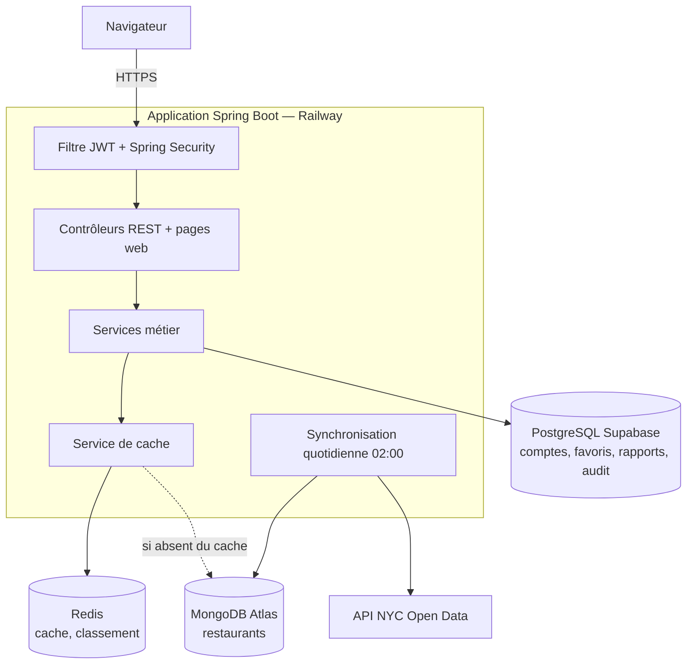
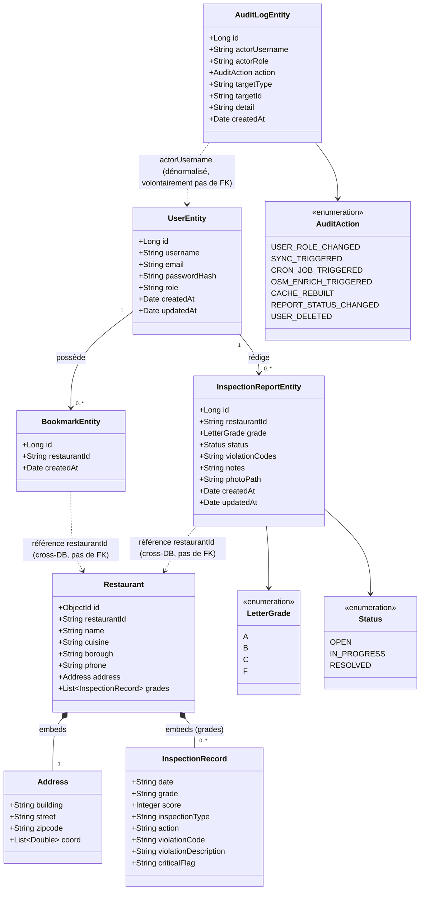
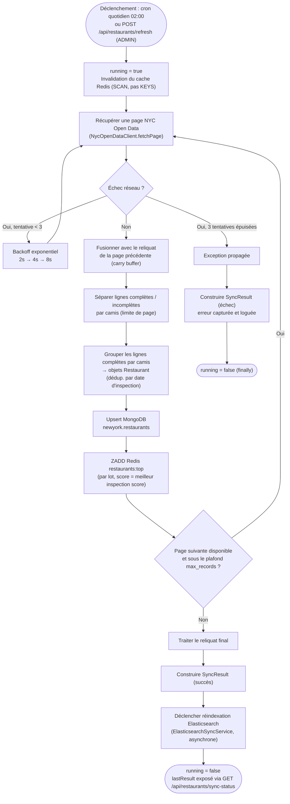
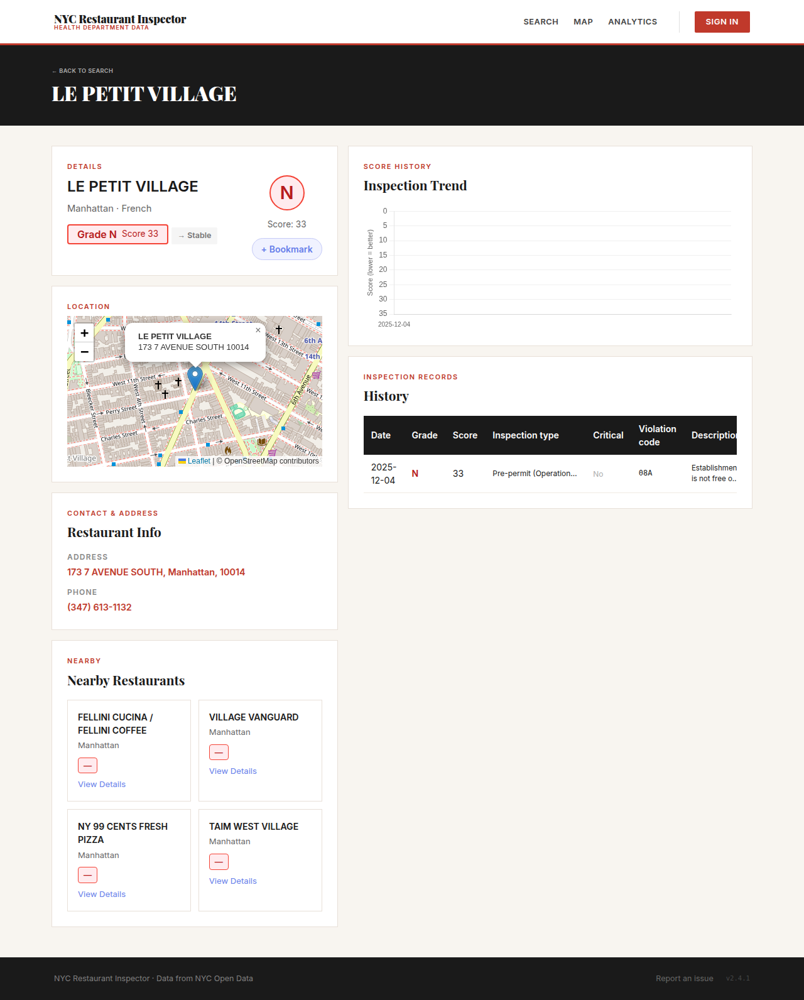
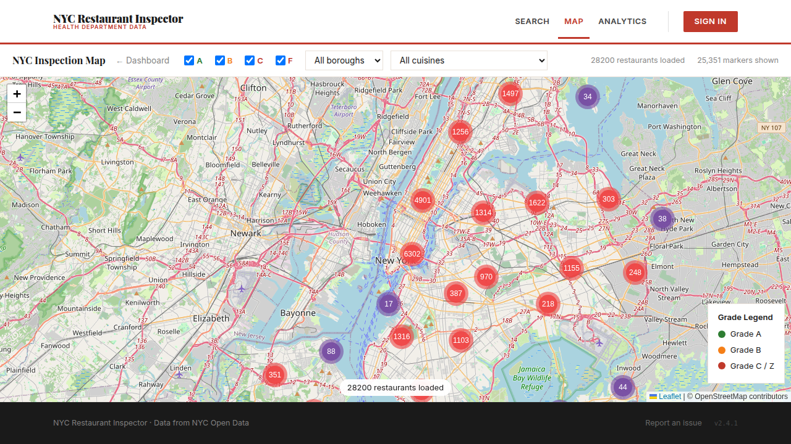
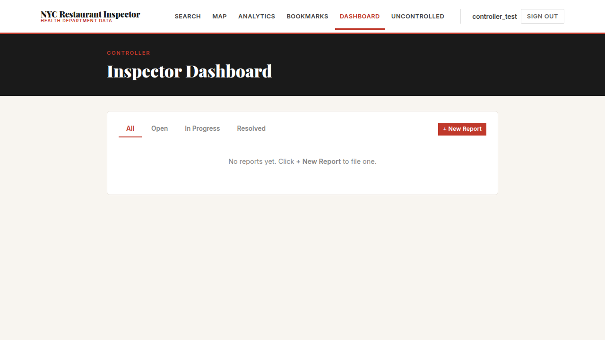

# Dossier technique — Application développée

**Certification** : RNCP niveau 7 — Expert en informatique et système d'information (3W Academy)
**Bloc** : 3 — Concevoir et développer une application informatique
**Livrable** : Application développée + dossier technique (évaluation individuelle)
**Candidat** : Arnaud Thery
**Application livrée** : `restaurant-analytics` — code source : <https://github.com/St4r4x/restaurant-analytics> ; application en production : <https://restaurant-app-production-3b11.up.railway.app>
**Version de référence** : 2.4.3, état au 02/10/2026

---

## 1. Présentation de l'application

`restaurant-analytics` est une application web qui permet d'explorer les résultats des inspections sanitaires des restaurants de New York. Les données publiques de la ville (NYC Open Data) sont synchronisées automatiquement chaque nuit dans l'application, qui les rend consultables par recherche, sur une carte et sous forme de statistiques.

L'application sert quatre profils :

| Profil | Ce qu'il peut faire |
|---|---|
| Visiteur anonyme | Rechercher un restaurant, consulter sa fiche et son historique d'inspections, explorer la carte et les statistiques, lister les restaurants non contrôlés |
| Client (`ROLE_CUSTOMER`) | Tout ce que fait le visiteur, plus : gérer ses favoris, voir les restaurants à proximité, supprimer son compte |
| Contrôleur (`ROLE_CONTROLLER`) | Rédiger des rapports d'hygiène terrain (grade, codes de violation, notes, photo) et suivre leur statut |
| Administrateur (`ROLE_ADMIN`) | Superviser les tâches planifiées, lancer une synchronisation, reconstruire le cache, gérer les rôles, consulter le journal d'audit |

L'application est en production sur Railway et redéployée automatiquement à chaque modification validée du code.

---

## 2. Fonctionnalités prévues et livrées

Les fonctionnalités prévues ont été priorisées selon la méthode MoSCoW (indispensable / important / confort). Toutes les fonctionnalités indispensables et importantes sont livrées et utilisables en production ; la documentation complète de l'API est publiée par l'application elle-même (Swagger UI, `/swagger-ui.html`) :

| Fonctionnalité | Priorité | Statut | Où la vérifier |
|---|---|---|---|
| Synchronisation quotidienne des données NYC Open Data | Indispensable | Livrée | `GET /api/restaurants/sync-status` |
| Recherche par nom ou adresse | Indispensable | Livrée | Barre de recherche de l'accueil, `GET /api/restaurants/search` |
| Fiche restaurant (grade, historique, carte, restaurants proches) | Indispensable | Livrée | Page `/restaurant/{id}` |
| Carte des inspections filtrable | Indispensable | Livrée | Page `/inspection-map` |
| Inscription, connexion, rôles | Indispensable | Livrée | Page `/login` |
| Rapports d'hygiène du contrôleur, avec photo | Indispensable | Livrée | Page `/dashboard` (profil contrôleur), `POST /api/reports` |
| Suppression de compte (RGPD) | Indispensable | Livrée | Page `/profile`, `DELETE /api/users/me` |
| Statistiques et indicateurs de la ville | Important | Livrée | Page `/analytics`, `GET /api/analytics/kpis` |
| Favoris | Important | Livrée | Bouton « + Bookmark » d'une fiche, page `/my-bookmarks` |
| Mot de passe oublié (email) | Important | Livrée | Lien « Forgot password? » de la page de connexion |
| Administration (synchronisation, cache, rôles, audit) | Important | Livrée | Page `/admin` |
| Export CSV des restaurants non contrôlés | Confort | Livrée | Bouton « Download CSV » de la page `/uncontrolled` |
| Classement des restaurants les mieux notés | Confort | Livrée | `GET /api/restaurants/top` |
| Autocomplétion de la recherche (Elasticsearch) | Confort | Livrée ; arrêtée en production de juillet à octobre 2026 pour raison de coût, réactivée le 02/10/2026 ; la recherche de base prend le relais si Elasticsearch est indisponible | `GET /api/restaurants/autocomplete` |
| Enrichissement OpenStreetMap (téléphone, site, horaires) | Confort | Retirée le 07/05/2026 : l'API Overpass est bloquée depuis l'hébergeur ; le téléphone provient désormais de NYC Open Data | — |


---

## 3. Environnement technique et choix des langages

### 3.1 Langages et technologies

| Langage / technologie | Usage | Pourquoi ce choix |
|---|---|---|
| **Java 25 + Spring Boot 4.0.5** | Serveur : API REST, sécurité, tâches planifiées | Écosystème mature pour la sécurité (Spring Security), l'accès aux données et les tests ; typage statique qui sécurise les évolutions |
| **HTML + JavaScript (Thymeleaf, sans framework)** | Interface web | Pages rendues par le serveur, sans étape de compilation front-end ; suffisant pour une interface de consultation |
| **Pipelines d'agrégation MongoDB** | Statistiques, recherche géographique | Les inspections arrivent ligne par ligne et sont regroupées par restaurant : le modèle document et ses agrégations (`$group`, `$geoNear`) s'y prêtent mieux que le SQL |
| **SQL via JPA / Hibernate (PostgreSQL)** | Comptes, favoris, rapports, audit | Données relationnelles qui exigent des contraintes d'unicité, des clés étrangères et des transactions (suppression de compte) |
| **Redis** | Cache des statistiques, classement | Réponses rapides sans recalculer les agrégations à chaque requête ; structure triée native pour le classement |
| **YAML (GitHub Actions, Docker Compose)** | Intégration et déploiement continus | Configuration versionnée avec le code, rejouable à l'identique |

### 3.2 Architecture



Organisation du code (`com.st4r4x`) : `controller/` (HTTP), `service/` (logique métier), `dao/` (requêtes MongoDB), `repository/` (accès PostgreSQL), `cache/`, `sync/` (synchronisation), `security/` (JWT, limitation de débit), `domain/` et `entity/` (modèles de données), `dto/` (objets échangés avec le client).

### 3.3 Modèle de données



Le modèle est scindé en deux : les restaurants et leurs inspections dans MongoDB (`domain/`), les données de l'application dans PostgreSQL (`entity/`). Aucune relation ORM ne les relie : les entités PostgreSQL référencent un restaurant par son identifiant `restaurantId`, sous forme de simple chaîne.

- `Address` et `InspectionRecord` sont embarqués dans le document `Restaurant` : un restaurant complet est écrit en un seul appel MongoDB.
- `BookmarkEntity` et `InspectionReportEntity` sont rattachés à `UserEntity` par une vraie clé étrangère (relation JPA `@ManyToOne`) : l'intégrité est garantie par PostgreSQL.
- `AuditLogEntity.actorUsername` est volontairement une chaîne et non une clé étrangère : l'historique d'audit survit à la suppression du compte qui l'a produit (l'auteur devient `[deleted-user]`).

### 3.4 Synchronisation des données NYC Open Data



Flux central de l'application : il alimente MongoDB, le cache Redis et l'index Elasticsearch, et absorbe les défaillances réseau de l'API source.

- Le reliquat (*carry buffer*) évite d'enregistrer incomplet un restaurant dont les inspections sont réparties sur deux pages de l'API (cas de test CT12).
- Trois tentatives avec backoff exponentiel absorbent une indisponibilité passagère de l'API sans faire échouer toute la synchronisation.
- `running = false` est garanti par un bloc `finally` : une synchronisation en échec ne bloque pas les suivantes.
- L'index Elasticsearch n'est reconstruit qu'après une synchronisation réussie, pour ne jamais indexer une donnée partielle.

---

## 4. Revue de code

### 4.1 Méthode

Chaque modification passe par une branche dédiée et une pull request, relue avant fusion et bloquée tant que les 5 vérifications de l'intégration continue ne sont pas vertes (section 6.4). En complément, une revue rétrospective de l'ensemble du code a été menée pour ce dossier, selon la grille ci-dessous, qui reprend les exigences de qualité du référentiel.

### 4.2 Grille de revue

| Critère | Constat | Exemple / mesure |
|---|---|---|
| Code commenté | Partiel : 30 fichiers sur 72 portent de la Javadoc (119 blocs) ; les classes à logique complexe sont documentées, les contrôleurs simples le sont peu | `RateLimitFilter` documente son algorithme et sa limite connue ; `AppConfig` documente l'ordre de résolution des propriétés |
| Variables et méthodes nommées | Conforme : noms explicites en anglais, méthodes nommées par leur intention | `findAtRiskRestaurants()`, `deleteByUserId()`, `requireValidPassword()` |
| Normes du langage | Conforme aux conventions Java : `camelCase`, une classe par fichier, journalisation par SLF4J et jamais par `System.out` (0 occurrence) ; 4 écarts mineurs (3 imports `*`, 1 `var`) | — |
| Code non dupliqué | Un point à corriger : l'enveloppe JSON de succès (`status` / `data`) est construite à la main 34 fois dans 6 contrôleurs | Les erreurs, elles, passent toutes par `ResponseUtil.errorResponse()` |
| Structuration | Conforme : séparation contrôleur / service / accès aux données respectée, connexion MongoDB centralisée (`MongoClientFactory`) | Aucune requête de base dans les contrôleurs de lecture |
| Sécurité | Conforme : contrôle d'accès par rôle, validation des entrées, erreurs internes masquées, jetons en cookies `HttpOnly` | Voir le plan de sécurité, section 7 |

### 4.3 Points forts

- **Séparation des responsabilités respectée** : `dao/` (accès MongoDB brut), `service/` (logique métier), `controller/` (HTTP), `repository/` (JPA/PostgreSQL) — pas de logique métier fuyant dans les contrôleurs.
- **Pas de duplication de la connexion MongoDB** : `MongoClientFactory` centralise l'instanciation, chaque DAO récupère l'instance via `getInstance().getDatabase(...)` plutôt que de recréer une connexion.
- **Gestion des erreurs cohérente** : `ResponseUtil.errorResponse()` centralise le format de réponse d'erreur JSON et empêche la fuite de stack traces vers le client.
- **Sécurité par défaut** : `SecurityConfig` déclare une politique `STATELESS` (pas de session serveur) et un ordre de règles explicite pour éviter qu'un wildcard plus large (`/api/reports/**`) ne masque une règle plus spécifique (`/api/reports/stats`).
- **Configuration fiable** : l'application refuse de démarrer si un secret obligatoire manque (`JWT_SECRET`, `RESEND_API_KEY`), plutôt que de tourner avec une valeur par défaut dangereuse.
- **Limitations connues documentées dans le code lui-même** : le commentaire de `RateLimitFilter` signale que les `ConcurrentHashMap` de buckets sont non bornées et propose la solution (`Guava CacheBuilder.expireAfterAccess()`) — pratique qui facilite la maintenance par un tiers.

### 4.4 Recommandations pour l'équipe de développement

| # | Recommandation | Fichier concerné | Justification | Statut |
|---|---|---|---|---|
| 1 | Sortir `jwt.secret` de `application.properties` vers une variable d'environnement obligatoire | `application.properties` | Un secret cryptographique ne doit jamais être versionné | **Appliquée** le 22/07/2026 (`JWT_SECRET` obligatoire, échec au démarrage sinon) |
| 2 | Factoriser l'enveloppe JSON de succès dans `ResponseUtil` (méthode `success(data)`) | `controller/` (6 fichiers) | Supprime 34 constructions identiques et garantit un format homogène | À faire |
| 3 | Remplacer les `ConcurrentHashMap` non bornées de `RateLimitFilter` par un cache à expiration | `security/RateLimitFilter.java` | Sous charge soutenue avec des IP variées, croissance mémoire non bornée | À faire |
| 4 | Ajouter une analyse statique de sécurité du code (SAST, ex. CodeQL) dans la CI | `.github/workflows/ci.yml` | Dependabot couvre les vulnérabilités des dépendances, mais rien n'analyse le code applicatif : le XSS corrigé en juillet (section 7.2) aurait pu être signalé par ce type d'outil | À faire |
| 5 | Vérifier au démarrage en production qu'aucun compte de test n'existe en base ; documenter la convention `@Profile("dev")` pour tout composant de démonstration | `startup/DataSeeder.java` | `@Profile("dev")` empêche la création de nouveaux comptes de test, mais n'a pas supprimé ceux créés avant son ajout (section 7.2) | Comptes supprimés ; contrôle à faire |
| 6 | Contrôler le type et le nom des fichiers envoyés comme photo de rapport | `controller/ReportController.java` | Le nom de fichier fourni par le client est réutilisé tel quel | À faire |
| 7 | Uniformiser l'injection de dépendances par constructeur (37 injections `@Autowired` sur champ subsistent) | `service/`, `controller/` | Facilite les tests et la lecture pour un nouveau contributeur | À faire |
| 8 | Compléter la Javadoc des contrôleurs et éliminer les 4 écarts de convention | `controller/` | Homogénéité du code | À faire |
| 9 | Documenter toutes les variables obligatoires dans `.env.example` | `.env.example` | `RESEND_API_KEY` manquait : une installation suivant le modèle échouait au démarrage | **Appliquée** le 01/10/2026 |
| 10 | Ne compter dans la limite anti-force brute que les routes qui la justifient | `security/RateLimitFilter.java` | Les appels de session (`/api/auth/me`, `/api/auth/refresh`), faits à chaque page, épuisaient le quota et déconnectaient l'utilisateur après quelques changements de page | **Appliquée** le 02/10/2026 (v2.4.2) |
| 11 | Ne rediriger vers la connexion que si la session est réellement expirée | `fragments/ux-utils.html`, pages protégées | Une erreur passagère (429, 5xx) était traitée comme une déconnexion | **Appliquée** le 02/10/2026 (v2.4.2) |
| 12 | Borner le pool de connexions PostgreSQL à la capacité du pooler | `application.properties` | Le pool par défaut (10 connexions par instance) saturait le pooler Supabase (15 clients) pendant un déploiement | **Appliquée** le 02/10/2026 (v2.4.3) |

---

## 5. Stratégie de tests

### 5.1 Niveaux de tests

| Niveau | Outil | Périmètre | Exemples |
|---|---|---|---|
| **Unitaire** | JUnit 5 + Mockito | Services, utilitaires, sécurité, synchronisation, avec dépendances simulées | `AuthServiceTest`, `PasswordResetServiceTest`, `SyncServiceTest`, `RateLimitFilterTest` |
| **Contrôleur (slice)** | `MockMvc` | Comportement HTTP (codes de statut, JSON, droits) sans démarrer toute l'application | `ReportControllerTest`, `UserControllerDeleteMeTest`, `RestaurantControllerSearchTest` |
| **Intégration** | JUnit 5 + Testcontainers (MongoDB et PostgreSQL réels dans des conteneurs éphémères) | Agrégations réelles, contraintes de schéma, Row-Level Security | `AnalyticsDAOIT`, `RestaurantDAOIT`, `UserRepositoryIT`, `PasswordResetTokenRepositoryIT`, `RowLevelSecurityIT` |
| **Configuration** | JUnit 5 | Chargement des propriétés et des beans Spring | `AppConfigTest`, `SecurityConfigTest` |
| **Fumée (bout en bout)** | Docker Compose + `curl` en CI | L'application complète démarre avec ses bases et répond | Job `e2e` : `GET /api/restaurants/health` doit répondre 200 |

Volume au 02/10/2026 : **43 classes de test** — 38 unitaires et de contrôleur totalisant 260 tests, 5 d'intégration totalisant 37 tests.

### 5.2 Objectifs

| Objectif | Mesure |
|---|---|
| Aucune régression ne passe en production sans être détectée | Fusion sur `main` impossible tant qu'un test échoue |
| Couvrir le code par des tests automatisés | Couverture des instructions ≥ 38 % (seuil bloquant en CI) |
| Tester la logique métier sans dépendre de l'infrastructure | Tests unitaires exécutables sans base de données |
| Vérifier les comportements que seule une vraie base révèle | Tests d'intégration sur MongoDB et PostgreSQL réels |
| Ne jamais réintroduire un bug corrigé | Tout correctif s'accompagne d'un test de non-régression |

### 5.3 Responsabilités

| Acteur | Responsabilité |
|---|---|
| Développeur (le candidat) | Concevoir les cas de test, écrire et maintenir les tests, analyser les échecs et la couverture |
| Relecteur de la pull request (le candidat, en relecture différée) | Vérifier que chaque fonctionnalité et chaque correctif arrive avec ses tests |
| Pipeline d'intégration continue | Exécuter toute la suite à chaque modification et bloquer la fusion en cas d'échec |

Dans une équipe, la relecture serait confiée à un autre développeur que l'auteur du code.

### 5.4 Tâches principales

1. **Analyser** l'exigence ou la règle de gestion à couvrir.
2. **Concevoir** les cas de test : cas nominal, cas d'erreur, cas limites (section 5.8).
3. **Implémenter** les tests au niveau adapté (unitaire, contrôleur, intégration).
4. **Exécuter** la suite en local (`mvn test`, puis `mvn failsafe:integration-test`), et automatiquement en CI à chaque push.
5. **Analyser** les résultats et le rapport de couverture JaCoCo publié sur chaque pull request.
6. **Corriger** les anomalies et ajouter un test de non-régression.
7. **Maintenir** la suite : mise à jour des tests à chaque évolution, suppression des tests devenus obsolètes.

### 5.5 Critères d'entrée et de sortie

| Critère | Règle appliquée |
|---|---|
| **Entrée** (avant de tester) | Le code compile (`mvn clean package`) ; la fonctionnalité est spécifiée ; toute nouvelle fonctionnalité arrive avec au moins un test du cas nominal |
| **Sortie** (avant de déployer) | 100 % des tests unitaires, de contrôleur et d'intégration réussis ; seuil de couverture JaCoCo respecté ; test de fumée réussi |

### 5.6 Risques couverts par les tests

- **Régression silencieuse sur les endpoints publics** — tests `MockMvc` de chaque contrôleur (codes de statut et format JSON).
- **Rupture de la limitation de débit** — `RateLimitFilterTest` vérifie le blocage (HTTP 429) après dépassement du quota.
- **Accès aux données d'un autre utilisateur** — `ReportControllerTest` vérifie qu'un contrôleur ne voit ni ne modifie les rapports d'un autre.
- **Rupture d'agrégation MongoDB** (carte, restaurants à risque, classement des cuisines) — `AnalyticsDAOIT` et `RestaurantDAOIT` sur une vraie base.
- **Échec de la suppression de compte RGPD** — `UserControllerDeleteMeTest`, dont un test de non-régression ajouté après le test d'intrusion de juillet 2026.
- **Déconnexions intempestives** — `RateLimitFilterTest.sessionEndpoints_areNotRateLimited` vérifie que les appels de session ne sont pas comptés dans la limite anti-force brute (non-régression du 02/10/2026).
- **Exposition des tables PostgreSQL** — `RowLevelSecurityIT` vérifie que la Row-Level Security est active sur toutes les tables.
- **Comptes de test en production** — `DataSeederTest` vérifie le comportement du composant de démonstration ; limite : il ne détecte pas des comptes déjà présents en base (recommandation 5).

Risque non couvert : l'interface web n'a pas de tests automatisés. La régression du 28/07/2026 sur la carte n'a été détectée que par une vérification manuelle après déploiement.

### 5.7 Environnement de tests

- **Tests unitaires et de contrôleur** : exécutés sans dépendance externe, en local comme en CI.
- **Tests d'intégration** (`*IT`) : Testcontainers démarre des conteneurs MongoDB et PostgreSQL éphémères pour chaque classe de test. Prérequis : Docker, et les variables `JWT_SECRET` et `RESEND_API_KEY` renseignées (valeurs de test en local, injectées par Infisical en CI), car le contexte Spring complet est chargé. Exécutés dans un job CI dédié (`mvn failsafe:integration-test`).
- **Test de fumée** : l'image de l'application et ses bases sont démarrées par Docker Compose dans la CI, puis interrogées.
- **Couverture** : mesurée par JaCoCo (`jacoco-maven-plugin` 0.8.14). Les packages `dto/`, `entity/`, `aggregation/` et `domain/` (objets de données sans logique) sont exclus du calcul. Un rapport HTML est publié à chaque exécution et un commentaire de couverture est ajouté sur chaque pull request.

### 5.8 Cas de tests représentatifs

Chaque cas est automatisé ; la colonne « Test » donne la classe et la méthode qui l'implémentent.

| ID | Exigence testée | Préconditions | Données et étapes | Résultat attendu | Test | Statut |
|---|---|---|---|---|---|---|
| CT01 | Un mot de passe faible est refusé à l'inscription | Aucune | Inscription avec un mot de passe de moins de 10 caractères | Inscription refusée avec un message explicite | `AuthServiceTest.register_throws_whenPasswordTooWeak` | Réussi |
| CT02 | Sans code d'inscription, le compte créé est un compte client | Aucune | Inscription valide sans code | Rôle `ROLE_CUSTOMER` attribué | `AuthServiceTest.register_assignsCustomerRole_whenNoSignupCode` | Réussi |
| CT03 | Un mot de passe erroné ne permet pas de se connecter | Compte existant | Connexion avec un mauvais mot de passe | Connexion refusée, aucun jeton émis | `AuthServiceTest.login_throws_whenPasswordIsWrong` | Réussi |
| CT04 | Un jeton invalide ou expiré n'authentifie pas | Aucune | Requête avec un cookie `access_token` expiré | Requête traitée comme anonyme | `JwtAuthenticationFilterTest.invalidOrExpiredTokenCookie_doesNotAuthenticate` | Réussi |
| CT05 | Les tentatives de connexion répétées sont bloquées | Quota d'authentification configuré | Envoi de requêtes au-delà du quota depuis une même IP | Réponse HTTP 429 | `RateLimitFilterTest.auth_returns429_afterThresholdExceeded` | Réussi |
| CT06 | Un rapport sans restaurant est refusé | Contrôleur connecté | `POST /api/reports` sans `restaurantId` | Réponse HTTP 400 | `ReportControllerTest.createReport_returns400_whenRestaurantIdMissing` | Réussi |
| CT07 | Un contrôleur ne voit que ses propres rapports | Deux contrôleurs ayant chacun des rapports | `GET /api/reports` par le premier | Seuls ses rapports sont renvoyés | `ReportControllerTest.listReports_doesNotReturnOtherControllersReports` | Réussi |
| CT08 | Un contrôleur ne peut pas modifier le rapport d'un autre | Rapport appartenant à un autre contrôleur | `PATCH /api/reports/{id}` | Réponse HTTP 403, rapport inchangé | `ReportControllerTest.patchReport_returns403_whenNotOwner` | Réussi |
| CT09 | Un lien de réinitialisation expiré est refusé | Jeton de plus d'une heure | Réinitialisation avec ce jeton | Refus « Invalid or expired reset link » | `PasswordResetServiceTest.resetPassword_throws_whenTokenExpired` | Réussi |
| CT10 | Un lien de réinitialisation n'est utilisable qu'une fois | Jeton déjà utilisé | Seconde réinitialisation avec le même jeton | Refus | `PasswordResetServiceTest.resetPassword_throws_whenTokenAlreadyUsed` | Réussi |
| CT11 | La suppression de compte efface aussi les jetons de réinitialisation (non-régression) | Utilisateur ayant demandé une réinitialisation | `DELETE /api/users/me` | Jetons supprimés avant le compte, réponse 200 | `UserControllerDeleteMeTest.deleteAccount_deletesPasswordResetTokensBeforeDeletingUser` | Réussi |
| CT12 | Un restaurant réparti sur deux pages de l'API source est enregistré en entier | Réponse source paginée | Synchronisation de deux pages | Restaurant complet, sans doublon | `SyncServiceTest.runSync_handlesCarryOverAcrossPages` | Réussi |
| CT13 | Un restaurant est « à risque » si sa dernière note est C ou Z | Base MongoDB réelle avec jeu de données connu | Comptage des restaurants à risque | Seuls les restaurants dont la dernière note est C ou Z sont comptés | `AnalyticsDAOIT.testCountAtRiskRestaurants_CountsOnlyLastGradeCOrZ` | Réussi |
| CT14 | Les tables PostgreSQL sont protégées par Row-Level Security | Base PostgreSQL réelle initialisée par l'application | Lecture du catalogue PostgreSQL | RLS active sur toutes les tables | `RowLevelSecurityIT.allTablesHaveRowLevelSecurityEnabled` | Réussi |
| CT15 | L'application déployée démarre et répond | Image construite, bases démarrées | `GET /api/restaurants/health` | Réponse HTTP 200 | Job CI `e2e` | Réussi à chaque push |
| CT16 | La vérification de session à chaque page n'épuise pas la limite anti-force brute (non-régression) | Quota d'authentification configuré | 10 appels successifs à `/api/auth/me` puis à `/api/auth/refresh` depuis une même IP | Toutes les réponses en 200, aucune en 429 | `RateLimitFilterTest.sessionEndpoints_areNotRateLimited` | Réussi |

### 5.9 Résultats et couverture

| Exécution | Résultat |
|---|---|
| Tests unitaires et de contrôleur (`mvn clean test`, 02/10/2026) | 260 exécutés, 0 échec |
| Tests d'intégration (`mvn failsafe:integration-test`, 01/10/2026, et CI à chaque pull request) | 37 exécutés, 0 échec |
| Couverture des instructions (JaCoCo, 02/10/2026) | **50,1 %** pour un seuil de 38 % |

**Objectif fixé vs atteint** : le seuil de 38 % avait été fixé à partir d'une couverture mesurée de 43 %, avec une marge pour absorber les évolutions du code. La couverture atteint aujourd'hui 50,1 %, grâce aux tests ajoutés pendant la revue de code et après le test d'intrusion : l'objectif est tenu. **Recommandation** : relever le seuil à 45 % pour verrouiller ce gain (le seuil ne doit jamais redescendre).

---

## 6. Procédures d'installation et déploiement continu

### 6.1 Installation locale (développement)

Prérequis : Git, Docker avec Docker Compose, Java 25 et Maven.

```bash
# 1. Cloner le dépôt et se placer dans le répertoire du projet
git clone https://github.com/St4r4x/restaurant-analytics.git && cd restaurant-analytics

# 2. Créer le fichier de configuration à partir du modèle
cp .env.example .env
# puis renseigner dans .env les valeurs marquées <FILL_IN> :
#   JWT_SECRET (openssl rand -hex 32), POSTGRES_PASSWORD, SPRING_DATASOURCE_PASSWORD,
#   RESEND_API_KEY (toute valeur non vide en local ; une vraie clé pour envoyer les emails)

# 3. Démarrer l'application et ses services (MongoDB, PostgreSQL, Redis, Elasticsearch)
docker compose up -d

# 4. Pour développer sans conteneur applicatif : build puis lancement direct
mvn clean package -DskipTests
java -jar target/quickstart-app-1.0-SNAPSHOT.jar
```

Les healthchecks de Docker Compose garantissent que les bases sont prêtes avant le démarrage de l'application. Pour une première synchronisation rapide lors d'un lancement sans conteneur (étape 4), limiter le volume importé en ajoutant `NYC_API_MAX_RECORDS=5000` dans `.env`.

### 6.2 Plan de test associé à l'installation

| Étape | Vérification | Résultat attendu |
|---|---|---|
| Après `docker compose up -d` | `docker compose ps` | Tous les services à l'état `healthy` |
| Après démarrage | `curl http://localhost:8080/api/restaurants/health` | HTTP 200 |
| Après la première synchronisation | `GET /api/restaurants/sync-status` | `completedAt` renseigné, nombre de restaurants > 0 |
| Interface | Ouvrir `http://localhost:8080` et lancer une recherche | Résultats affichés |
| Sécurité | `GET /api/admin/cron/status` sans être connecté, puis avec un compte client | HTTP 401, puis HTTP 403 |
| Documentation API | Ouvrir `/swagger-ui.html` | Liste des endpoints affichée |
| Tests automatisés | `mvn test` puis `mvn test-compile failsafe:integration-test failsafe:verify` | 0 échec |

### 6.3 Scripts d'installation

| Script / fichier | Rôle |
|---|---|
| `.env.example` | Modèle de configuration listant toutes les variables obligatoires |
| `docker-compose.yml` | Orchestration des 5 services (app, mongodb, postgres, redis, elasticsearch) avec healthchecks |
| `Dockerfile.ci` | Construction de l'image applicative utilisée par la CI |
| `railway.toml` | Commande de build explicite pour l'hébergement Railway |
| `.tool-versions` | Version de Java (25) utilisée par les outils de version locaux (mise, asdf) |
| Variable Railway `RAILPACK_JDK_VERSION=25` | Version de Java imposée au build **et à l'exécution** en production (Railpack utilise Java 21 par défaut) |
| `.github/workflows/ci.yml` | Pipeline d'intégration continue (section 6.4) |
| `.github/workflows/backup-postgres.yml` | Sauvegarde quotidienne chiffrée de la base PostgreSQL |
| `.github/workflows/release.yml` | Préparation d'une version : numéro de version et section du `CHANGELOG.md` |

### 6.4 Pipeline d'intégration continue (plan de tests automatisé)

À chaque push et sur chaque pull request, GitHub Actions exécute :

| Job | Vérification | Bloquant pour la fusion |
|---|---|---|
| `secrets` | Recherche de secrets committés (gitleaks) | Oui |
| `build` | Compilation et construction du JAR | Oui |
| `unit-test` | Tests unitaires et de contrôleur, seuil de couverture JaCoCo | Oui |
| `integration-test` | Tests d'intégration sur bases réelles (Testcontainers) | Oui |
| `e2e` | Démarrage de toute la pile Docker Compose et test de santé | Oui |

La branche `main` est protégée : une pull request ne peut être fusionnée que si ces 5 vérifications réussissent.

### 6.5 Déploiement continu (production — Railway)

1. **Déclenchement** : chaque fusion sur `main` déclenche un nouveau build et un déploiement automatique sur Railway, une fois la CI validée.
2. **Build** : `railway.toml` fixe la commande Maven ; la variable `RAILPACK_JDK_VERSION=25` impose Java 25 au build et à l'exécution. Sans elle, Railpack exécute l'application sur Java 21, ce qui la fait planter au démarrage (`UnsupportedClassVersionError`, incident du 02/10/2026).
3. **Configuration** : les variables d'environnement sont injectées par Railway au démarrage (`MONGODB_URI`, `MONGODB_DATABASE`, `MONGODB_COLLECTION`, `REDIS_HOST`, `REDIS_PORT`, `JWT_SECRET`, identifiants PostgreSQL, `RESEND_API_KEY`).
4. **Ressources** : la JVM est limitée à 75 % de la mémoire du conteneur (`MaxRAMPercentage=75.0`) ; le pool de connexions PostgreSQL est limité à 5 par instance, car l'ancienne et la nouvelle instance tournent en parallèle pendant la bascule et le pooler Supabase n'accepte que 15 clients.
5. **Vérification après déploiement** : appel de `GET /api/restaurants/health` et contrôle visuel des pages principales.
6. **Retour arrière** : redéploiement de la version précédente depuis le tableau de bord Railway.

---

## 7. Plan de sécurité

### 7.1 Mesures en place

| Domaine | Mesure | Implémentation |
|---|---|---|
| Authentification | Jetons JWT signés : accès 15 min, rafraîchissement 7 jours, stockés en cookies `HttpOnly`, `Secure`, `SameSite=Strict` | `JwtUtil`, `JwtAuthenticationFilter`, `AuthController` |
| Mots de passe | Hachage BCrypt ; 10 caractères minimum dont une majuscule et un chiffre | `SecurityConfig`, `ValidationUtil` |
| Autorisation | Contrôle d'accès par rôle sur chaque endpoint sensible ; vérification de propriété des rapports | `SecurityConfig`, `@PreAuthorize`, `ReportController` |
| Limitation de débit | 10 requêtes/min par IP sur la connexion, l'inscription et la réinitialisation de mot de passe ; 100 sur la recherche et la carte ; les appels de session (`/api/auth/me`, `/api/auth/refresh`) ne sont pas limités, car ils exigent un jeton valide | `RateLimitFilter` (Bucket4j) |
| Erreurs | Message générique au client, détail uniquement dans les journaux du serveur | `ResponseUtil.errorResponse()` |
| Injection | Paramètres traités comme des valeurs (pas d'interprétation des opérateurs MongoDB) ; échappement HTML des champs de rapport avant insertion dans la page | `dao/`, `escapeHtml()` |
| En-têtes HTTP | HSTS, `X-Content-Type-Options`, `X-Frame-Options`, CORS restrictif | `SecurityConfig` |
| Secrets | Aucun secret dans le dépôt ; scan automatique à chaque push ; démarrage refusé si un secret obligatoire manque | Variables d'environnement, job `secrets` (gitleaks), `AppConfig` |
| Base PostgreSQL | Row-Level Security réactivée à chaque démarrage | `schema.sql` |
| Dépendances | Alertes sur les vulnérabilités connues | GitHub Dependabot |
| Traçabilité | Journal des actions administrateur et des suppressions de compte | `AuditService`, `audit_log` |
| Données personnelles | Suppression de compte en cascade (rapports, photos, favoris, jetons) | `DELETE /api/users/me` |
| Sauvegarde | Export quotidien chiffré (GPG AES256) de PostgreSQL, conservé 30 jours ; MongoDB reconstructible depuis la source | `backup-postgres.yml` |

### 7.2 Tests de sécurité réalisés

Un test d'intrusion a été mené le 29/07/2026 contre l'instance de production, dont le candidat est propriétaire. Trois vulnérabilités ont été trouvées, corrigées, déployées et revérifiées en production le jour même :

| Gravité | Vulnérabilité | Correction |
|---|---|---|
| Critique | 3 comptes de démonstration aux identifiants publics restés actifs en production, dont un ayant eu les droits administrateur jusqu'au 19/05/2026 | Comptes supprimés ; identifiants revérifiés comme rejetés |
| Élevée | La suppression de compte échouait pour tout utilisateur ayant demandé une réinitialisation de mot de passe (clé étrangère non gérée) | Suppression en cascade des jetons + test de non-régression (CT11) |
| Moyenne | XSS stocké dans le panneau d'édition des rapports | Échappement HTML systématique des champs concernés |

Contrôles vérifiés sans faille : en-têtes de sécurité, CORS, injection NoSQL, attributs des cookies, élévation de privilèges (4 tentatives bloquées), accès aux favoris d'un autre compte, anti-énumération sur la réinitialisation de mot de passe. L'analyse des journaux n'a révélé aucune action privilégiée effectuée par les comptes exposés. Rapport complet dans le dépôt, fichier certification/bloc4a-2-pentest.md.

### 7.3 Risques résiduels et plan d'action

| Priorité | Action | Effort estimé |
|---|---|---|
| 1 | Journaliser les connexions réussies et échouées (horodatage, compte, IP tronquée) | 2-3 h |
| 1 | Contrôler au démarrage l'absence de comptes de démonstration en production | 1-2 h |
| 1 | Publier une politique de confidentialité (finalités, durées de conservation, droits) | 1 jour |
| 2 | Stocker les photos dans un stockage objet avec liens signés et contrôle du type de fichier | 1-2 jours |
| 2 | Pseudonymiser le nom d'utilisateur conservé dans l'entrée d'audit de suppression de compte | 1 h |
| 3 | Rotation annuelle du secret JWT | Procédure, sans développement |
| 3 | Analyse statique de sécurité (SAST) en CI | Configuration |

---

## 8. Plan de maintenance

### 8.1 Types de maintenance

| Type | Déclencheur | Traitement |
|---|---|---|
| Corrective | Anomalie signalée par un utilisateur ou détectée en production | Branche de correctif, test de non-régression, CI, déploiement, entrée `CHANGELOG.md` |
| Préventive | Alerte Dependabot, recommandation de revue de code, risque de sécurité | Mise à jour de dépendance ou correctif planifié ; toute alerte critique traitée sous 7 jours |
| Évolutive | Nouvelle fonctionnalité | Cycle spécification → plan → implémentation → pull request |
| Adaptative | Changement de l'hébergeur ou de l'API source | Adaptation de la configuration ou du connecteur (exemples : retrait de l'enrichissement OpenStreetMap quand l'API est devenue inaccessible ; variable `RAILPACK_JDK_VERSION` ajoutée quand Railpack a changé de version de Java par défaut) |

### 8.2 Tâches planifiées

| Tâche | Heure | Rôle |
|---|---|---|
| Synchronisation NYC Open Data | 02:00 | Rafraîchissement des données restaurants (`SyncService`) |
| Réchauffement du cache Redis | 02:30 | Reconstruction du classement après la synchronisation (`CronScheduler`) |
| Réindexation Elasticsearch | 04:00 | Reconstruction de l'index de recherche (l'index est aussi recréé automatiquement au démarrage s'il est vide) |
| Sauvegarde PostgreSQL | 03:17 UTC | Export chiffré conservé 30 jours (GitHub Actions) |

Statut consultable via `GET /api/admin/cron/status` (rôle administrateur). Aucune alerte automatique n'est encore émise en cas d'échec : la surveillance reste manuelle.

### 8.3 Procédure en cas d'incident

| Symptôme | Action |
|---|---|
| Synchronisation en échec | Consulter `GET /api/restaurants/sync-status` pour le détail de l'erreur ; relancer via le bouton « Sync NYC Data » de la page d'administration une fois la cause corrigée |
| Statistiques incohérentes ou périmées | Bouton « Rebuild Cache » de la page d'administration (`POST /api/admin/rebuild-cache`) |
| Application indisponible | `GET /api/restaurants/health` en premier diagnostic ; journaux dans le tableau de bord Railway (production) ou `docker compose logs -f app` (local) |
| Application qui refuse de démarrer | Lire le message d'erreur : une variable obligatoire manque (`JWT_SECRET`, `RESEND_API_KEY`) ; la renseigner puis redémarrer |
| Déploiement qui plante avec `UnsupportedClassVersionError` | L'environnement d'exécution n'est pas en Java 25 : vérifier la variable `RAILPACK_JDK_VERSION=25` sur le service, puis redéployer (incident du 02/10/2026) |
| Déploiement qui plante avec `EMAXCONNSESSION max clients reached` | Le pooler PostgreSQL est saturé : vérifier qu'aucune instance de développement n'est branchée sur la base de production et que le pool est limité à 5, puis redéployer (incident du 02/10/2026) |
| Perte de données PostgreSQL | Restauration depuis la dernière sauvegarde chiffrée (`docs/backup-restore.md`) |

### 8.4 Support utilisateur

**Canaux** :
- un lien « Report an issue » en pied de chaque page et un bouton flottant en bas à droite de chaque page ouvrent directement un ticket GitHub pré-rempli (`[BUG]`) ;
- le guide utilisateur (annexe A) répond aux questions courantes sur l'utilisation de l'application ;
- pour les développeurs et intégrateurs, la documentation de l'API est disponible sur `/swagger-ui.html` et la documentation technique dans `docs/`.

**Traitement d'une demande** :

1. Réception du ticket GitHub et qualification : anomalie, question d'utilisation ou demande d'évolution.
2. Priorisation : bloquante (sécurité, perte de données, service indisponible) traitée immédiatement ; gênante dans la semaine ; mineure planifiée.
3. Pour une question d'utilisation : réponse dans le ticket en renvoyant au guide utilisateur, puis enrichissement du guide si la question est nouvelle.
4. Pour une anomalie : reproduction, correctif avec test de non-régression, déploiement, entrée dans `CHANGELOG.md`, fermeture du ticket avec la version corrigée.

Amélioration prévue : créer le modèle de ticket `bug_report.md` vers lequel pointe déjà le lien (étapes pour reproduire, résultat attendu, navigateur), absent du dépôt à ce jour.

### 8.5 Montée de version

Toute évolution suit le cycle documenté dans `docs/superpowers/` (spécification → plan → exécution) et se conclut par une mise à jour de `CHANGELOG.md`, du numéro de version (`app.semver`, affiché en pied de page) et, si nécessaire, de `docs/architecture.md` et `docs/api.md`.

---

## Annexe A — Guide utilisateur

L'interface de l'application est en anglais ; les libellés cités ci-dessous sont ceux affichés à l'écran.

### A.1 Consulter les inspections (sans compte)

1. **Rechercher un restaurant** : sur la page d'accueil, saisir un nom ou une adresse dans la barre « Search by restaurant name or address… ».
2. **Lire une fiche** : la fiche affiche le grade sanitaire actuel (A = meilleur, puis B, C ; Z = en attente de notation), l'historique des scores (plus le score est bas, meilleure est l'inspection), le détail des inspections et les restaurants situés à moins de 500 m.
3. **Explorer la carte** (menu « Map ») : les marqueurs sont colorés par grade et filtrables par quartier (borough), cuisine et grade.
4. **Consulter les statistiques** (menu « Analytics ») : indicateurs de la ville, distribution des grades par quartier, cuisines les mieux et les moins bien notées, restaurants à risque.
5. **Restaurants non contrôlés** (menu « Uncontrolled ») : restaurants notés C ou Z, ou sans inspection depuis plus de 12 mois ; le bouton « Download CSV » exporte la liste.





### A.2 Créer un compte et se connecter

1. Page de connexion, onglet « Create Account » : nom d'utilisateur, email et mot de passe (10 caractères minimum, dont une majuscule et un chiffre).
2. Le champ « Inspector Code » reste vide pour un compte client ; les contrôleurs y saisissent le code qui leur a été fourni.
3. Onglet « Sign In » pour se connecter ; « Sign Out » pour se déconnecter.
4. Mot de passe oublié : lien « Forgot password? », saisir son email ; le lien reçu est valable une heure et ne sert qu'une fois.

### A.3 Client : favoris

- Sur une fiche restaurant, le bouton « + Bookmark » ajoute le restaurant aux favoris (il devient « ✓ Saved ») ; un nouveau clic le retire.
- La page « My Bookmarks » liste les favoris ; le tableau de bord (menu « Dashboard ») affiche aussi les restaurants proches si la géolocalisation du navigateur est autorisée.

### A.4 Contrôleur : rapports d'hygiène

1. Tableau de bord, bouton « New Report » : rechercher le restaurant, choisir le grade, le statut, saisir les codes de violation (par exemple `04L,10F`) et des notes, joindre une photo si besoin.
2. Le rapport est créé avec le statut « Open » par défaut ; il peut ensuite passer à « In Progress » puis « Resolved » depuis le tableau de bord.
3. Chaque contrôleur ne voit et ne modifie que ses propres rapports.



### A.5 Administrateur

La page « Admin Panel » permet de relancer la synchronisation (« Sync NYC Data »), de reconstruire le cache (« Rebuild Cache »), de suivre l'état des tâches planifiées, de modifier le rôle d'un utilisateur, de consulter le journal d'audit et de télécharger la liste des restaurants à risque en CSV.

### A.6 Questions fréquentes

| Question | Réponse |
|---|---|
| Les données sont-elles à jour ? | Elles sont synchronisées chaque nuit à 02:00 depuis NYC Open Data. |
| Je ne reçois pas l'email de réinitialisation. | Vérifier les courriers indésirables ; pour des raisons de sécurité, l'application ne confirme pas si l'email existe. Refaire une demande si le lien a expiré (validité : une heure). |
| Comment supprimer mon compte et mes données ? | Page « Profile », section « Delete Account » : la suppression est immédiate et définitive (compte, favoris, rapports et photos). |
| Pourquoi un restaurant n'a-t-il pas de grade ? | Certaines inspections ne donnent pas lieu à un grade (inspection initiale en attente de contre-visite) ; la fiche affiche alors le score et l'historique. |
| J'ai rencontré une erreur. | Utiliser le lien « Report an issue » en bas de page en décrivant les étapes suivies. |
